<!-- SPDX-License-Identifier: AGPL-3.0-only -->
<div align="center">

<h1>PlainGym</h1>

<p><strong>Free and open source gym management for martial arts academies and boutique gyms.</strong><br>
Run your gym on your terms, with your data on your own server.</p>

<p>
<a href="LICENSE"></a>
<a href="https://github.com/plaingym/plaingym/actions/workflows/ci.yml"></a>
</p>

[Install](docs/install.md) · [Try the demo](docs/demo.md) · [Documentation](docs/README.md) · [Contributing](CONTRIBUTING.md) · [Changelog](CHANGELOG.md)

</div>

<p align="center">
<a href="apps/server/src/demo/screenshots/members-light-2x-97447fedba731822.webp">
<picture>
  <source media="(prefers-color-scheme: dark)" srcset="apps/server/src/demo/screenshots/members-dark-2x-b62aec57ccae1389.webp">
  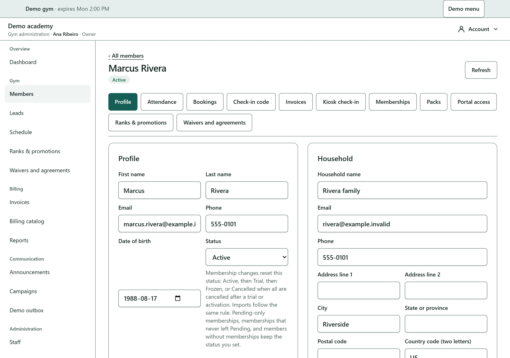
</picture>
</a>
</p>

> [!NOTE]
> PlainGym 1.0.0 is the first stable release. Patch releases (1.0.Z) carry fixes only
> and installs apply them each night, with rollback ([versioning](docs/versioning.md)).

## Why PlainGym

PlainGym runs a whole gym from one install: the staff admin, members and families,
classes and booking, ranks, a check-in kiosk, a member app, billing, waivers and an
optional website.

- **Your own data.** Member records and payments stay on a server you control.
- **Open standards.** PostgreSQL, Docker and a documented API keep your setup portable.
- **Open source.** Read, change and share the code under the AGPL-3.0 license.
- **Free to self-host.** Install it on your own server at no cost. Payments go through
  your gym's own Stripe account, and PlainGym takes no cut.

## Features

### Members and households

Families, contact details and member records in one place. One payer per household,
statuses, tags, photos, emergency contacts and staff-only medical notes.

<p align="center">
<a href="apps/server/src/demo/screenshots/members-light-2x-97447fedba731822.webp">
<picture>
  <source media="(prefers-color-scheme: dark)" srcset="apps/server/src/demo/screenshots/members-dark-2x-b62aec57ccae1389.webp">
  
</picture>
</a>
</p>

### Ranks and promotions

Belts and stripes, or kyu and dan. Set criteria for classes, time at rank and age,
see who is ready, and promote several members together.

<p align="center">
<a href="apps/server/src/demo/screenshots/ranks-light-2x-d14683cdd88fb0db.webp">
<picture>
  <source media="(prefers-color-scheme: dark)" srcset="apps/server/src/demo/screenshots/ranks-dark-2x-09ba79eb1a9b7cba.webp">
  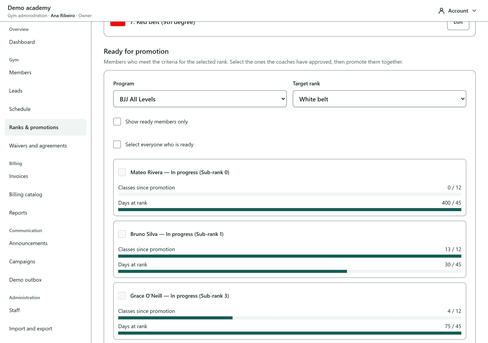
</picture>
</a>
</p>

### Schedule and booking

Weekly class templates with capacity limits, a waitlist that moves people up on its
own, a cancellation cutoff, and attendance taken by coaches.

<p align="center">
<a href="apps/server/src/demo/screenshots/schedule-light-2x-2f8fe56e1aece4e8.webp">
<picture>
  <source media="(prefers-color-scheme: dark)" srcset="apps/server/src/demo/screenshots/schedule-dark-2x-d9be280eb360caef.webp">
  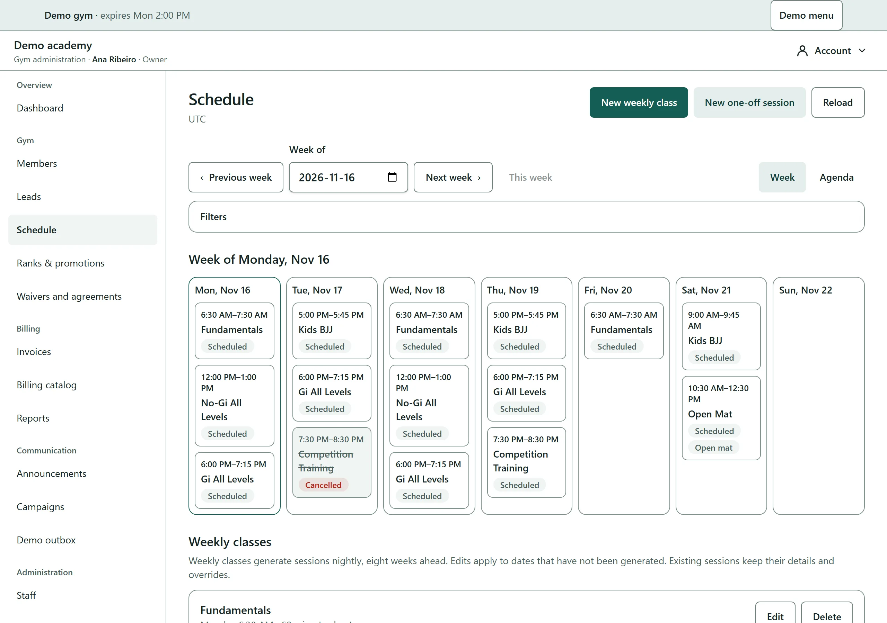
</picture>
</a>
</p>

### Billing with your own Stripe

Memberships, signup fees, family discounts, promo codes and class packs. Stripe
collects card details and, when enabled, US or Canadian bank account details
through Checkout. Failed payments can be retried through a payment link.

<p align="center">
<a href="apps/server/src/demo/screenshots/billing-light-2x-df8e853ff278efa0.webp">
<picture>
  <source media="(prefers-color-scheme: dark)" srcset="apps/server/src/demo/screenshots/billing-dark-2x-a692d03d36f9cb26.webp">
  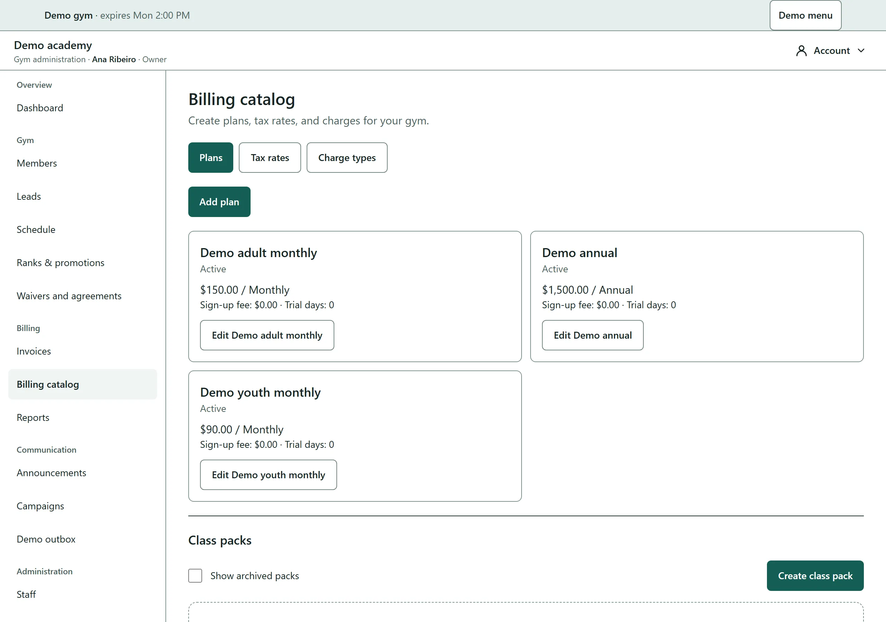
</picture>
</a>
</p>

### Leads and reports

A leads board with sources and conversion, member activity, revenue by plan,
attendance by program, and member emails.

<p align="center">
<a href="apps/server/src/demo/screenshots/reports-light-2x-267ca821f61b9e2b.webp">
<picture>
  <source media="(prefers-color-scheme: dark)" srcset="apps/server/src/demo/screenshots/reports-dark-2x-bbd3af526c26cf10.webp">
  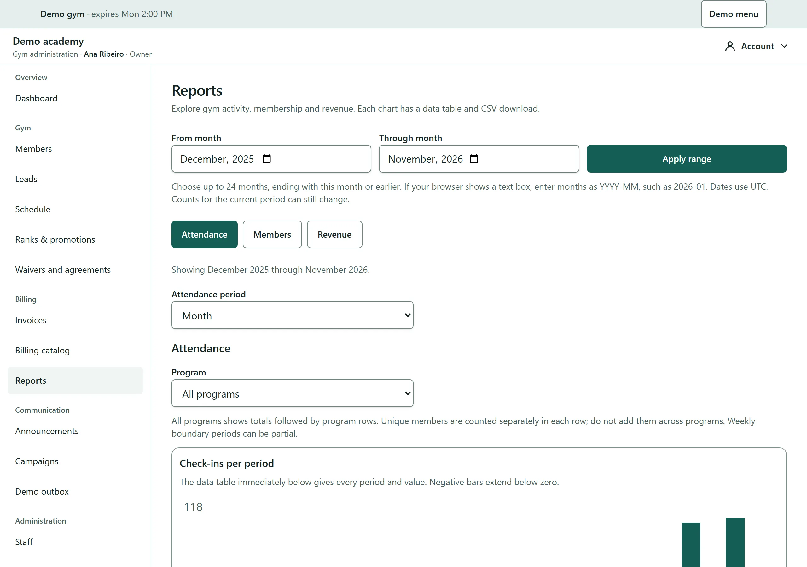
</picture>
</a>
</p>

### Join, trial, drop-in

Public sign-up straight through to the member portal, trial requests sent to staff,
and drop-in waivers signed before class.

<p align="center">
<a href="apps/server/src/demo/screenshots/join-light-2x-916852a6dcae42ec.webp">
<picture>
  <source media="(prefers-color-scheme: dark)" srcset="apps/server/src/demo/screenshots/join-dark-2x-ced274c0240fd53f.webp">
  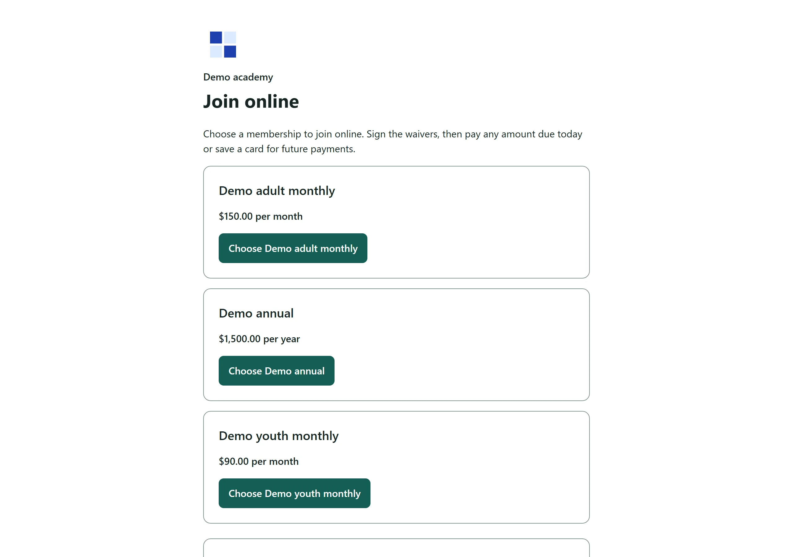
</picture>
</a>
</p>

### Member portal

An installable app for members: book classes, show a check-in QR code, follow rank
progress, pay invoices and manage the household.

<p align="center">
<a href="apps/server/src/demo/screenshots/portal-light-2x-63ad5ca4862917e4.webp">
<picture>
  <source media="(prefers-color-scheme: dark)" srcset="apps/server/src/demo/screenshots/portal-dark-2x-c68e7643347f4e9b.webp">
  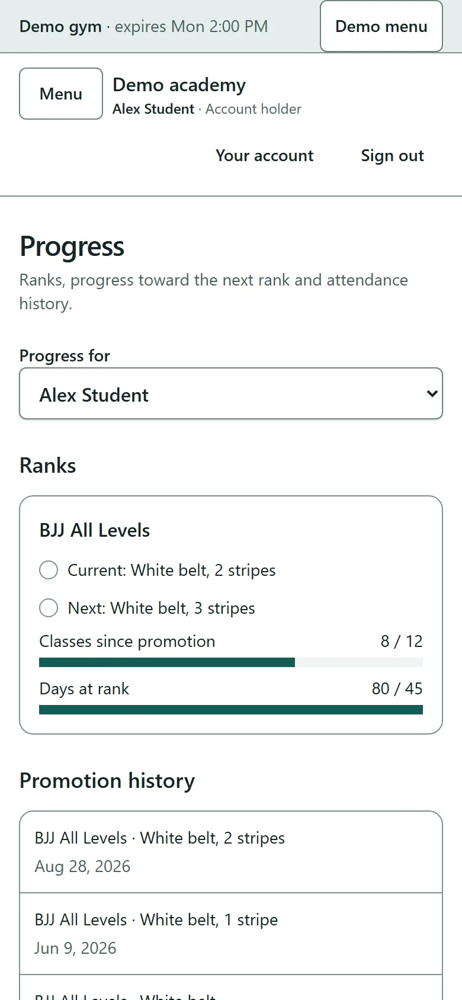
</picture>
</a>
</p>

### Waivers and onboarding

Waiver templates with guardian signing for minors and a PDF of each signed copy.
One link collects a payment method and a waiver, and offers a portal invite.

<p align="center">
<a href="apps/server/src/demo/screenshots/waivers-light-2x-271f7f171557ca3f.webp">
<picture>
  <source media="(prefers-color-scheme: dark)" srcset="apps/server/src/demo/screenshots/waivers-dark-2x-b3f94c66bc43402c.webp">
  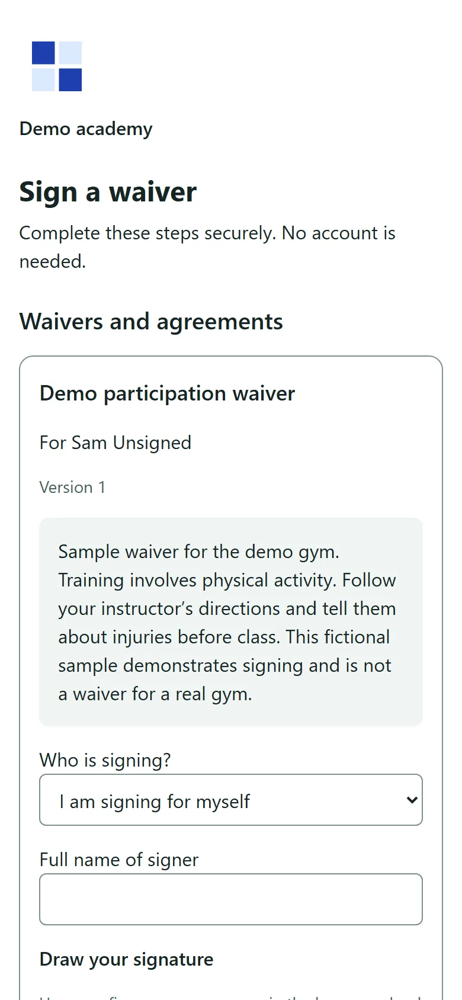
</picture>
</a>
</p>

### Check-in kiosk

A tablet at the front desk. Members check in with a name and PIN or a QR code,
families together. Payment issues stay off the shared screen.

<p align="center">
<a href="apps/server/src/demo/screenshots/kiosk-light-2x-878443562ecbc931.webp">
<picture>
  <source media="(prefers-color-scheme: dark)" srcset="apps/server/src/demo/screenshots/kiosk-dark-2x-99c97c16c13801ce.webp">
  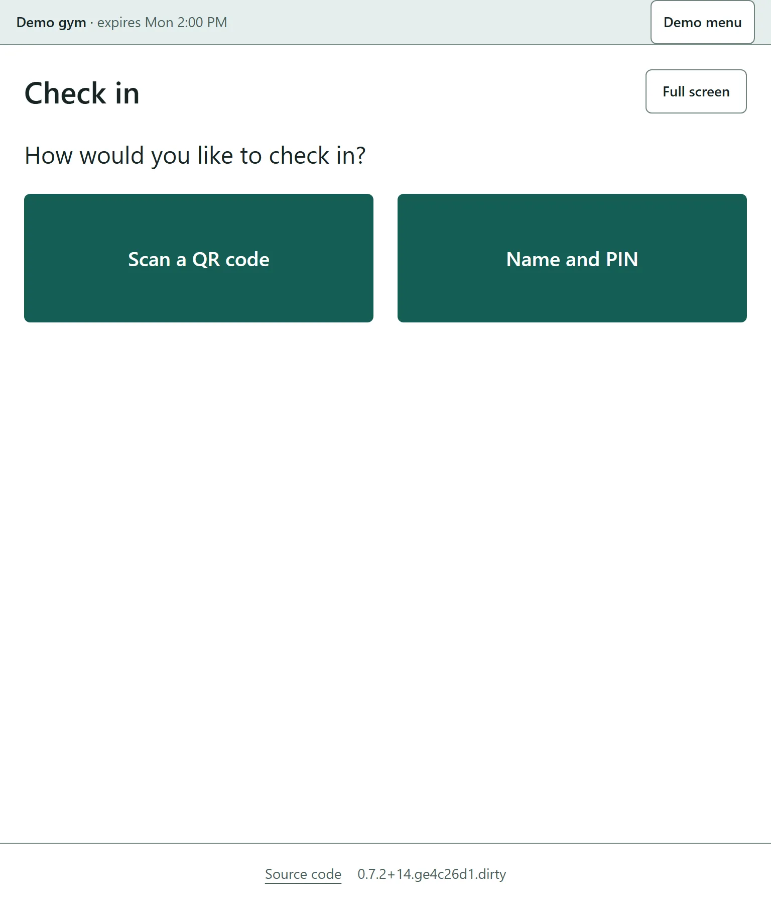
</picture>
</a>
</p>

### Your server, looked after

A one-command install and setup wizard, encrypted backups with restore, nightly patch
updates with rollback, health checks, CSV import and export, and an optional gym website.

<p align="center">
<a href="apps/server/src/demo/screenshots/server-light-2x-412bdd1d8e544229.webp">
<picture>
  <source media="(prefers-color-scheme: dark)" srcset="apps/server/src/demo/screenshots/server-dark-2x-42aec3f8e4e9dad3.webp">
  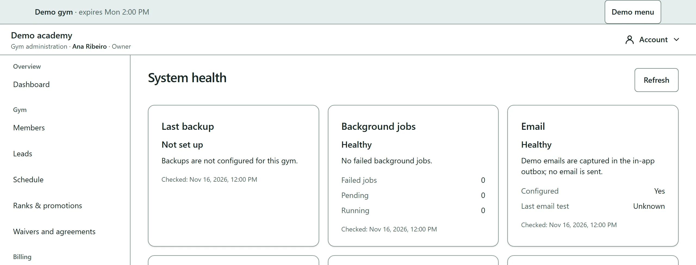
</picture>
</a>
</p>

Nothing in the app assumes one martial art. [Content packs](packs/README.md) bring the
rank systems for BJJ, judo and karate, and suggested programs and class tags for those
and for Muay Thai and functional fitness.

## Get started

You need a domain name, a small Ubuntu server (2 GB of RAM recommended) and about 30
minutes. The [install guide](docs/install.md) assumes you have never run a server before.

| Step | What you do | Guide |
| :--- | :--- | :--- |
| 1. Install | Point a name at the server and run one command. It prints a private setup link. | [Install](docs/install.md) |
| 2. Set up | Open the link and follow the setup wizard. Store the backup key it shows once. | [Setup wizard](docs/self-hosting.md#setup-wizard) |
| 3. Bring your members | Import from CSV, collect cards again and invite members to the portal. | [Importing](docs/importing.md) · [Cards](docs/card-recollection.md) · [Portal](docs/member-portal.md) |
| 4. Go live | Turn on billing and member emails. | [Going live](docs/going-live.md) |

```sh
curl -fsSL https://github.com/plaingym/plaingym/releases/latest/download/bootstrap.sh \
  | sudo sh -s -- --hostname gym.example.org --email owner@example.org
```

After that the server mostly runs itself: see [what happens each night](docs/updating.md),
[updating by hand](docs/update-by-hand.md) and [restoring after losing a server](docs/restoring.md).

## Try the demo

The [sandbox demo](docs/demo.md) runs a sample gym on your computer or a server. Look
around the shared showcase, then make a private copy and switch between owner, coach and
student without creating an account. Copies are deleted within 24 hours, and billing
uses Stripe test mode.

## How it works

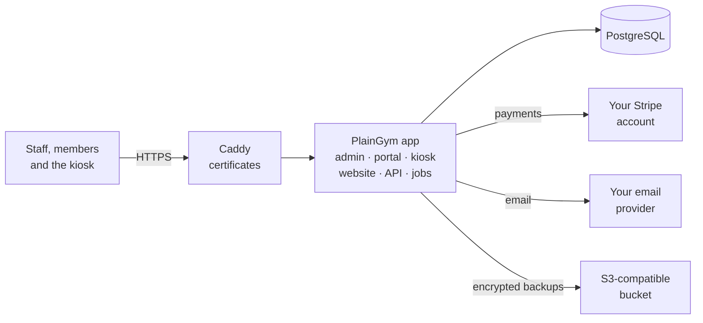

- **One install, one gym.** Docker Compose runs three containers: Caddy, the app and
  PostgreSQL. It fits in 1 GB of RAM with swap, on amd64 or arm64.
- **Strict separation.** Every query is scoped to the gym and checked by PostgreSQL's
  row-level security; a member only ever sees their own household.
- **No lock-in.** Stripe, email and storage sit behind small modules, and **Export gym data**
  downloads a ZIP with one CSV per dataset.

The details are in the [architecture](docs/architecture.md) and the
[security model](docs/security-model.md).

## Documentation

| For | Start with |
| :--- | :--- |
| Gym owners | [Install](docs/install.md), [self-hosting](docs/self-hosting.md), [importing](docs/importing.md), [member portal](docs/member-portal.md), [going live](docs/going-live.md) |
| Operators | [Configuration](docs/configuration.md), [install reference](docs/install-reference.md), [update reference](docs/update-reference.md), [restore reference](docs/restore-reference.md), [Cloudflare](docs/cloudflare.md) |
| Contributors | [Development](docs/development.md), [architecture](docs/architecture.md), [security model](docs/security-model.md), [versioning](docs/versioning.md) |

Every page is listed in the [documentation index](docs/README.md).

## Development

You need Node **24.22.1**, pnpm **10.34.7** and Docker. Copy `.env.example` to `.env`,
fill in its secrets as described in [development](docs/development.md#local-development),
then:

```sh
pnpm install
pnpm dev:up    # PostgreSQL and Mailpit
pnpm dev       # server on :3000, web app on :5173
pnpm verify    # types, lint and the tests your branch affects
```

[Development](docs/development.md) covers the rest: the sandbox demo over local HTTPS,
builds, and how the tests and checks work.

## Contributing

Pull requests are welcome. Read [CONTRIBUTING.md](CONTRIBUTING.md) first: you sign the
[Contributor License Agreement](CLA.md) once, and you keep your copyright. AI agents
follow [AGENTS.md](AGENTS.md). Please report security issues privately as described in
[SECURITY.md](SECURITY.md), and follow the [code of conduct](CODE_OF_CONDUCT.md).

## License

PlainGym is licensed under the [GNU Affero General Public License v3.0 only](LICENSE).
If you run a modified version for others, the AGPL asks you to offer them its source;
every running install links to its own source code. Third-party notices are in
[THIRD_PARTY_LICENSES](THIRD_PARTY_LICENSES).
